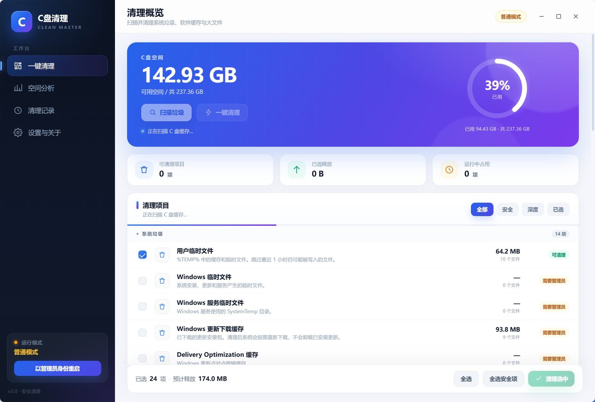
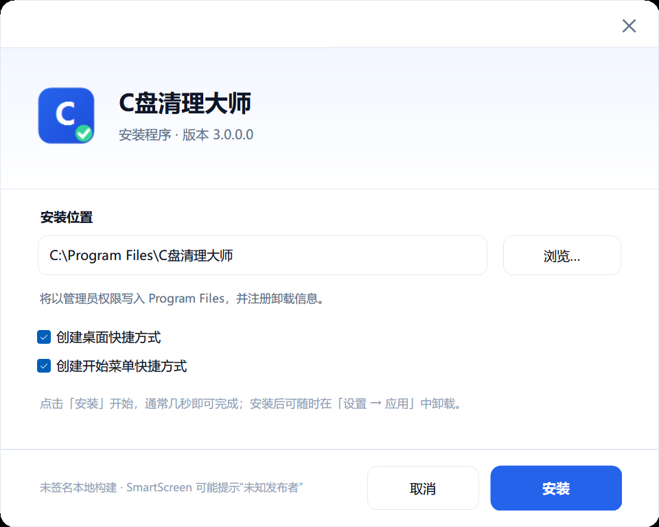
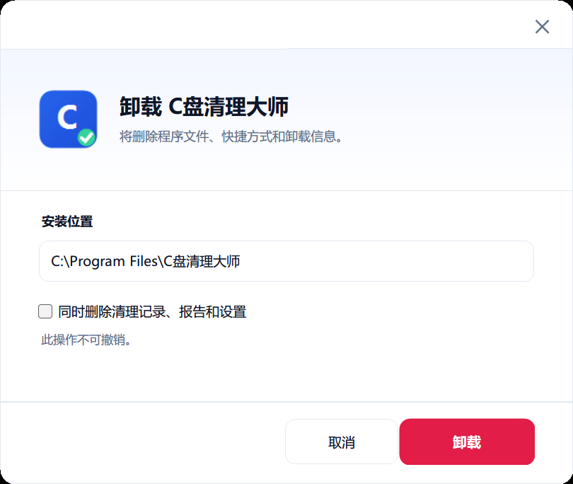

# C盘清理大师 v3.0

现代化界面的 Windows C 盘清理软件。基于 WebView2 构建界面，保留 v2 的安全清理引擎，新增更完整的软件缓存、DeepSeek Harness 旧版本清理、空间分析和 HTML 报告。

[](https://github.com/lichenzhen0713/C-Drive-Cleaner/releases/latest)



## 下载

| 文件 | 说明 |
| --- | --- |
| [CDriveCleaner-3.0-Setup.exe](https://github.com/lichenzhen0713/C-Drive-Cleaner/releases/download/v3.0/CDriveCleaner-3.0-Setup.exe) | 单文件安装包（x64，需要管理员权限） |
| [CDriveCleaner-3.0-portable-win64.zip](https://github.com/lichenzhen0713/C-Drive-Cleaner/releases/download/v3.0/CDriveCleaner-3.0-portable-win64.zip) | 便携版，解压即用 |

仓库内的 `release\` 目录同时保留中文名的同名文件（`C盘清理大师-3.0-安装包.exe`、`C盘清理大师-v3.0-win64.zip`）。

## 运行要求

- Windows 10 / 11（64 位）
- Microsoft Edge WebView2 Runtime（Windows 11 和大部分 Windows 10 已自带）
  - 如提示缺失，安装：<https://go.microsoft.com/fwlink/p/?LinkId=2124703>
- 不需要安装 .NET SDK；程序使用系统自带的 .NET Framework 4.8

## 安装包（推荐）

发行文件：`release\C盘清理大师-3.0-安装包.exe`（约 470 KB，x64，单文件）

1. 双击运行，Windows 弹出 UAC 提示时选择「是」（写入 `Program Files` 和卸载信息需要管理员权限）。
2. 可在安装界面修改安装位置；勾选是否创建桌面 / 开始菜单快捷方式；点「安装」。
3. 安装完成后可勾选「立即运行」，或从开始菜单启动。
4. 卸载：打开「设置 → 应用 → 已安装的应用」，找到「C盘清理大师 3.0.0.0」点「卸载」；也可直接运行安装目录下的 `Uninstall.exe`。

安装程序写入的内容：

- 程序文件：默认 `C:\Program Files\C盘清理大师\`
- 卸载信息：`HKLM\SOFTWARE\Microsoft\Windows\CurrentVersion\Uninstall\CDriveCleaner`
- 快捷方式：公共开始菜单，以及可选的公共桌面

卸载时会先关闭正在运行的 C盘清理大师，删除程序文件、快捷方式和注册表项；清理记录、报告与设置（`%LOCALAPPDATA%\CDriveCleaner`）默认保留，可在卸载界面勾选一并删除。





## 启动（便携版）

解压 `C盘清理大师-v3.0-win64.zip` 后：

1. 保持 `C盘清理大师.exe` 与以下 DLL 在同一个文件夹：
   - `Microsoft.Web.WebView2.Core.dll`
   - `Microsoft.Web.WebView2.WinForms.dll`
   - `WebView2Loader.dll`
2. 双击 `C盘清理大师.exe`。程序默认以**管理员身份**运行，Windows 会弹出 UAC 提示；取消则不会启动。
3. 首次启动自动扫描，也可以点击「扫描垃圾」。
4. 勾选项目，点「清理选中」；或点「一键清理」自动选中安全项。
5. 如果顶部提示应用正在占用缓存，点「关闭程序并清理」，确认后会自动关闭浏览器/微信/抖音/电脑管家等，重新扫描并清理安全项。Office 不会被自动关闭，请先手动保存。

> 程序未做代码签名，SmartScreen 可能提示“未知发布者”。这是本地编译的绿色软件，可点「更多信息 → 仍要运行」。

## 界面

- 深色侧边栏 + 渐变仪表盘
- 圆环显示 C 盘已用比例
- 卡片式清理项目列表，状态标签区分「可清理 / 需要管理员 / 运行中」
- 支持「全选 / 取消全选」，也支持只选安全项
- 检测到应用占用缓存时，显示「关闭程序并清理」按钮：关闭浏览器、微信、抖音、电脑管家等，自动重新扫描并清理安全项（Office 需手动关闭）
- 过滤器：全部 / 安全 / 深度 / 已选
- 窗口默认居中显示；最大化只占工作区，不遮挡任务栏
- 窗口右上角三个控制按钮：最小化 / 最大化（最大化后变为还原图标）/ 关闭
- 空间分析页：大文件、文件夹占用 Top 10
- 清理记录页：历史报告入口
- 设置页：自动扫描、高级项目、二次确认、运行中清理、DSH 图片保留天数

## 清理范围

**系统垃圾**：用户临时文件、Windows Temp / SystemTemp、Windows 更新下载缓存、Delivery Optimization、缩略图/图标缓存、WER、崩溃转储、内存转储、CBS/DISM 日志、回收站、字体缓存、Prefetch、WinSxS 组件清理（DISM）、休眠文件（如存在）。

**浏览器**：Chrome、Edge、Brave、Vivaldi、Firefox 的 Cache、Code Cache、GPU/Shader 缓存、Service Worker 缓存；不动 Cookie、密码、历史记录。

**软件缓存**：微信内置浏览器、VS Code、Trae CN、Cursor、Windsurf、Discord、Slack、Teams、Spotify、Notion、Obsidian、Postman、Figma、Office WebView、Office 加载项包（默认关闭）、抖音、番茄小说下载器、微软电脑管家。

**开发工具**（高级、默认不勾选）：npm、pnpm、Yarn、pip、NuGet HTTP 缓存、Gradle、Cargo、Go 构建缓存。

**DeepSeek Harness**：

- 旧版本 `DeepSeek Harness.new-{GUID}` 目录：校验当前安装目录、目录年龄和进程占用。
- 更新包残留：仅删除与已安装版本一致的包；发现待安装新版本会保留。
- 界面缓存：DSH 运行中也可清理未占用文件。
- 会话图片缓存：只删除超过设定天数（默认 7 天）的缓存。
- 旧日志：7 天前。

**不会删除** `.dsh\sessions`、`.dsh\attachments`、`.dsh\profiles`、`.dsh\.credentials.yaml`、`.dsh\storages`。

## 安全设计

- 扫描只读，清理前二次确认（可在设置中关闭）。
- 默认跳过运行中的应用、被占用文件、目录联接/符号链接。
- 设置中可开启「运行中清理」，只尝试删除未占用缓存，默认关闭且需要风险确认。
- 被占用文件删除失败不会中断，错误写入报告。
- 不触碰文档、下载、桌面、聊天记录、账号凭据。
- 不清理 `WinSxS`、`C:\Windows\Installer`、`Program Files` 等高风险目录；WinSxS 仅通过 DISM 官方命令清理。

## 报告与日志

数据目录：`%LOCALAPPDATA%\CDriveCleaner`

- `reports\clean-*.html`：HTML 清理报告
- `logs\clean-*.log`：详细日志
- `history.tsv`：清理记录索引
- `settings.ini`：设置
- `WebView2\`：界面缓存

## 构建

需要 Windows 自带 .NET Framework 4.x 的 `csc.exe`，以及 `lib\webview2` 下的 WebView2 SDK 文件。

```powershell
powershell -NoProfile -ExecutionPolicy Bypass -File .\build.ps1
```

默认生成需要管理员权限的正式版。开发调试可加 `-Dev` 生成普通权限版本：

```powershell
powershell -NoProfile -ExecutionPolicy Bypass -File .\build.ps1 -Dev
```

输出目录：`dist\`，包含 exe 和三个 WebView2 DLL。

主程序源码：

```text
src/WebHost.cs    WinForms + WebView2 宿主、消息桥、扫描/清理调度
src/Program.cs    入口
ui/index.html     HTML/CSS/JS 界面（编译时嵌入 exe）
lib/webview2      WebView2 SDK 与 Loader
```

### 构建安装包

安装程序（`installer\`）用同一套 `csc.exe` 编译，不依赖 Inno Setup / NSIS / WiX：

```powershell
powershell -NoProfile -ExecutionPolicy Bypass -File .\build-installer.ps1
```

产物：

- `release\C盘清理大师-3.0-安装包.exe`：单文件安装包（内嵌程序负载 + 卸载程序 + 图标）
- `release\C盘清理大师-v3.0-win64.zip`：便携版

可选参数：

| 参数 | 作用 |
| --- | --- |
| `-SkipAppBuild` | 复用 `dist` 中已编译的主程序 |
| `-Preview` | 额外编译 `tools\preview-installer.exe`，预览安装 / 卸载界面 |
| `-Test` | 额外编译 `tools\test-install.exe`，跑安装-卸载全流程自测（用 HKCU 与临时目录，不影响系统） |

预览与自测：

```powershell
.\tools\preview-installer.exe            # 安装界面
.\tools\preview-installer.exe --done     # 安装完成界面
.\tools\preview-installer.exe --uninstall
.\tools\test-install.exe .\dist          # 自动化测试，全部通过返回 0
```

安装程序源码：

```text
installer/Installer.cs        安装界面与流程
installer/Uninstaller.cs      卸载界面
installer/InstallEngine.cs    解压、写卸载程序、快捷方式、卸载项注册表
installer/UninstallEngine.cs  关闭进程、删快捷方式、删注册表、删文件
installer/Core.cs             路径、快捷方式、进程、图标等公共逻辑
installer/Ui.cs               无边框圆角窗口、按钮、进度条等自绘控件
installer/manifest.xml        安装 / 卸载程序清单（requireAdministrator）
```

界面按 96 DPI 设计，运行时按窗口 DPI（`GetDpiForWindow`）等比缩放，150% 缩放下同样清晰。

核心清理引擎复用 `../C-Drive-Cleaner-App/src` 下的 Models / Fs / Catalog / Engine。

## 常见问题

**界面一片空白 / 提示 WebView2 初始化失败？**
安装 Microsoft Edge WebView2 Runtime 后重试。Windows 11 通常已自带。

**为什么某些项目显示“需要管理员”？**
系统级目录需要管理员权限，点左下角「以管理员身份重启」。

**为什么应用缓存显示“运行中”？**
应用正在使用缓存。关闭它后点「重新扫描」；或在设置中开启「运行中清理」。

**DISM 很慢？**
DISM 组件清理可能需要几分钟到几十分钟，默认不勾选。

**清理后需要重启吗？**
一般不需要；被占用文件可重启后再次清理。
